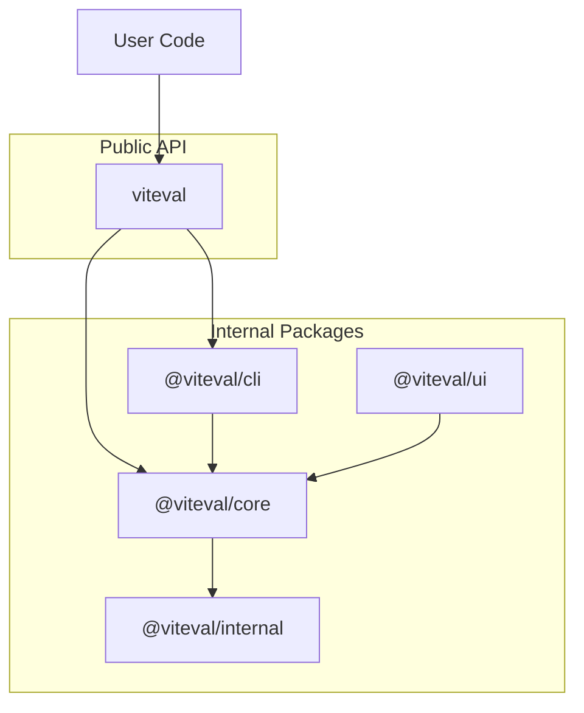

# Architecture

How Viteval packages are structured and work together.

## Overview

Viteval is composed of multiple packages that work together to provide a unified API. The `viteval` package is the main entry point for users, re-exporting everything from internal packages.



## Package Responsibilities

### viteval (main package)

The unified entry point. Users install this single package and get everything they need.

```ts
// User imports from viteval
import { evaluate, createScorer, defineDataset } from 'viteval';
```

Re-exports from `@viteval/core` and includes the CLI binary.

### @viteval/core

The evaluation engine. Provides:

- `evaluate()` - Run evaluation suites
- `createScorer()` - Define custom scoring functions
- `defineDataset()` - Create reusable datasets
- `defineConfig()` - Configuration helpers
- Built-in scorers and reporters

### @viteval/cli

Command-line interface built on maltty. Uses maltty commands, logging, prompts,
and progress indicators for project initialization, dataset generation, and the UI.
Evaluation arguments pass directly to Vitest. Provides:

- `viteval run` - Execute evaluations
- `viteval init` - Initialize projects
- `viteval data` - Manage datasets
- `viteval ui` - Inspect local results

The optional compiled CLI uses maltty's Bun bundler. Help, version, and project
initialization run inside the binary. Evaluations, dataset imports, and the UI
run through the project's installed Node CLI, preserving Vitest workers and
project-specific dependencies.

### @viteval/ui

TanStack Start + React dashboard for exploring evaluation results, datasets, and
metrics. TanStack Router file routes preserve dashboard, results, datasets,
suites, settings, and `/api/*` URLs. Route loaders render project data on the
server; React handles filtering, case expansion, and tagging after hydration.

Vite builds browser assets into `dist/client` and the Start request handler into
`dist/server/server.js`. The public `server.mjs` launcher and `server.d.mts`
declarations retain `createVitevalServer()` and its start, restart, shutdown, and
exit-waiting API. The launcher starts a Node child process whose Hono bridge
serves browser assets and forwards dynamic requests to Start. The selected
project root is passed to that process through `VITEVAL_ROOT_PATH`.

`pnpm dev:ui examples/basic` runs the Vite development server on port 6274.
Production checks exercise the packaged launcher, not the development server.

### @viteval/internal

Shared utilities used across packages. Type guards, helpers, and common types. Not published for external use.

## Built on Vitest

Evaluations run as Vitest test suites, leveraging its speed, parallelization, and ecosystem.

The CLI owns argument parsing, help, and Viteval configuration. It uses internal
Vitest programmatic primitives for discovery, execution, and watch mode. Each
evaluation records its structured result as a custom Vitest artifact, which reporters
consume from the reported test case. This keeps evaluation data on Vitest's supported
worker-to-main-process transport instead of mutating internal task metadata.

Viteval owns `viteval.config.ts`. The CLI translates its `eval` options at the
runner boundary; an internal setup entry loads worker-local model/storage instances.
Used storage integrations initialize lazily and close after result persistence.
Destination arrays select independent dataset and result writers. JSON persistence
produces dashboard-readable snapshots without requiring a reporter. Runner
configuration, setup, and reporter adapters are internal, not public integrations.
No custom task transport is used.
