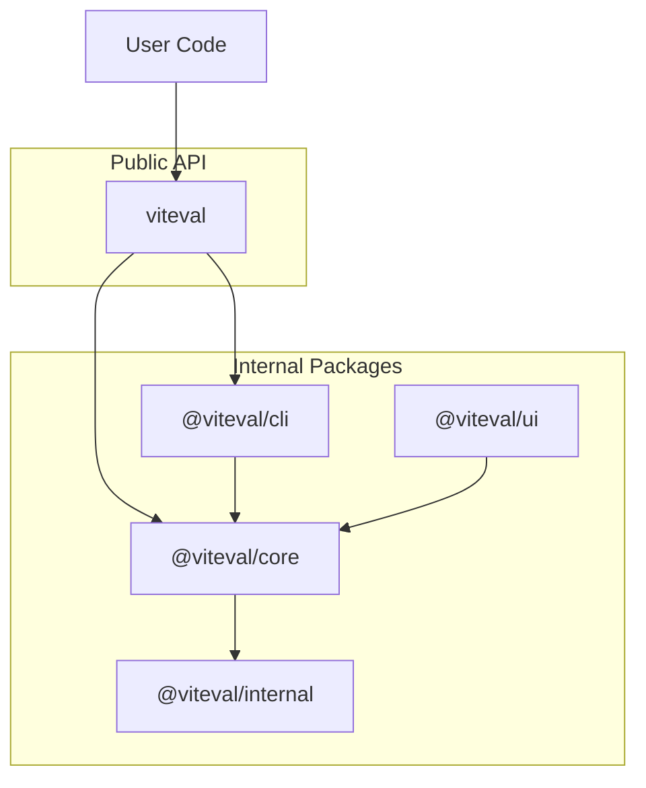

# Architecture

How Viteval packages are structured and work together.

## Overview

Viteval is composed of multiple packages that work together to provide a unified API. The `viteval` package is the main entry point for users, re-exporting everything from internal packages.



## Package Responsibilities

### viteval (main package)

The unified entry point. Users install this single package and get everything they need.

```ts
// User imports from viteval
import { evaluate, createScorer, defineDataset } from 'viteval';
```

Re-exports from `@viteval/core` and includes the CLI binary.

### @viteval/core

The evaluation engine. Provides:

- `evaluate()` - Run evaluation suites
- `createScorer()` - Define custom scoring functions
- `defineDataset()` - Create reusable datasets
- `defineConfig()` - Configuration helpers
- Built-in scorers and reporters

### @viteval/cli

Command-line interface built on maltty. Uses maltty commands, logging, prompts,
and progress indicators for project initialization, dataset generation, and the UI.
Evaluation arguments pass directly to Vitest. Provides:

- `viteval run` - Execute evaluations
- `viteval init` - Initialize projects
- `viteval data` - Manage datasets
- `viteval ui` - Inspect local results

The optional compiled CLI uses maltty's Bun bundler. Help, version, and project
initialization run inside the binary. Evaluations, dataset imports, and the UI
run through the project's installed Node CLI, preserving Vitest workers and
project-specific dependencies.

### @viteval/ui

Web interface for viewing results. React-based dashboard for exploring evaluation results, datasets, and metrics.

### @viteval/internal

Shared utilities used across packages. Type guards, helpers, and common types. Not published for external use.

## Built on Vitest

Evaluations run as Vitest test suites, leveraging its speed, parallelization, and ecosystem.

The CLI uses Vitest's native CLI for argument parsing, configuration, discovery,
execution, watch mode, reporting, failure semantics, and exit status. Each
evaluation records its structured result as a custom Vitest artifact, which reporters
consume from the reported test case. This keeps evaluation data on Vitest's supported
worker-to-main-process transport instead of mutating internal task metadata.

Viteval uses native `vitest.config.ts` files. Non-serializable model and provider
instances initialize in Vitest `setupFiles`, inside each worker. Viteval does not
provide a custom runner, plugin, virtual config module, default reporter, or task transport.
